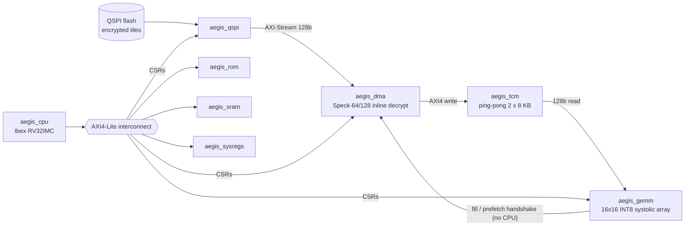

# AegisAI-SoC: Secure Edge-AI Accelerator SoC

A RISC-V SoC that streams **encrypted neural-network tiles** from QSPI flash, **decrypts them on the fly in hardware** (Speck-64/128), and feeds a **16×16 INT8 systolic array**, with the CPU out of the data path. It is built the way an industry SoC is built: **separately verified IPs**, each packaged as a Vivado IP, integrated in an IP Integrator block design, and verified again as a whole with real firmware.



## The three ideas

| # | Idea | How it is implemented | Evidence |
|---|---|---|---|
| 1 | **Inline Speck-64/128 stream decryption in the DMA** | `speck_decryptor` sits between the QSPI FIFO and the AXI write channel; 27 rounds, 29 cycles per 128-bit beat vs 32 cycles per beat from QSPI, so it keeps up with the flash and needs no staging buffer or CPU copy | Published test vector, 200 random round-trips, stalls and key reload pass; DMA test decrypts and writes 256 B tiles through the whole path |
| 2 | **CPU-bypassed hardware handshake** | GEMM controller raises `dma_auto_prefetch`; DMA fetches the next tile into the other TCM bank and answers with `fill_done/fill_bank`; the CPU only starts the first tile and releases results | Ping-pong A/B/A/B and back-pressure tests; 7 tile-sequencer scenarios incl. early/late prefetch, slow CPU, ROWS=0 error |
| 3 | **Zero-sensing PEs with micro clock gating** | Operand isolation when an operand is zero; a PE's output registers are clock-gated only when inputs *and* held state are all zero, so results are bit-exact. Clock-enable form for FPGA, latch ICG form (`PE_CLK_GATE=1`) for ASIC | `tb_pe`: gated PE == plain PE every cycle (32.3 % of cycles gated on zero-heavy stimulus); array test: multiplier idle in 37 % (dense) to 99.3 % (90 % sparse) of PE-cycles, 0 result errors on 304 rows, both gating modes |

## IP-based flow

Every folder under `ip/` is one IP with its own RTL, testbench(es), spec and file list. `soc/` only integrates.

| IP | Contents | Standalone testbench |
|---|---|---|
| `aegis_cpu` | lowRISC Ibex + 2 OBI→AXI4-Lite shims | via SoC test |
| `aegis_dma` | CPU-bypassed DMA + Speck-64/128 | `tb_dma`, `tb_speck` |
| `aegis_qspi` | QSPI flash read engine (EBh / 6Bh), RX FIFO, back-pressure | `tb_qspi` |
| `aegis_tcm` | ping-pong tightly-coupled memory (block RAM) | `tb_tcm` |
| `aegis_gemm` | 16×16 array + tile sequencer + 64×16 result buffer | `tb_pe`, `tb_gemm`, `tb_gemm_subsys` |
| `aegis_fabric` | 2-master × 6-slave AXI4-Lite crossbar | `tb_fabric` |
| `aegis_rom/sram/sysregs` | boot ROM (firmware baked into the IP), SRAM, system registers | via SoC test |
| `aegis_common` | `axil_regif`, `reset_sync` | `tb_regif`, `tb_reset_sync` |

~2,900 lines of own SystemVerilog + ~2,400 lines of testbench code (Ibex is vendored, see `THIRD_PARTY.md`).

## Verification results

| Level | Result |
|---|---|
| 11 Verilator testbenches (IPs, fabric, shared blocks, full SoC) | all pass |
| **Full SoC, RTL** (Ibex boots the ROM, 4 encrypted tiles → Speck → TCM → GEMM → CPU copies results) | 1,536 result words vs software model: **0 mismatches** (82,627 cycles) |
| **Full SoC, Vivado block design** (packaged IPs + AMD SmartConnect, xsim) | **0 mismatches** (205,711 cycles: SmartConnect latency ≈ 2.5×, behaviour identical) |

## FPGA synthesis (Vivado 2025.2, Artix-7 xc7a100t, synthesis only)

| Block | LUTs | FFs | BRAM36 | DSP | WNS @10 ns |
|---|---:|---:|---:|---:|---:|
| aegis_cpu | 3,005 | 2,064 | 0 | 1 | -4.09 (≈71 MHz est.) |
| aegis_dma | 1,121 | 1,650 | 0 | 0 | +3.63 |
| aegis_qspi | 830 | 909 | 0 | 0 | +4.07 |
| aegis_tcm | 310 | 186 | 4 | 0 | +6.25 |
| aegis_gemm | 23,491 | 10,350 | 4.5 | 0 | +1.88 |
| aegis_fabric | 707 | 32 | 0 | 0 | +7.51 |
| aegis_rom / sram / sysregs | 8 / 11 / 56 | 52 / 99 / 164 | 4 / 4 / 0 | 0 | ≥ +6.6 |
| **Whole SoC (block design)** | **30,060 (47 %)** | **16,756** | **16.5** | 1 | **+6.08 @ 20 ns (50 MHz met)** |

Pre-placement estimates; place-and-route and power are future work (see below).

## Repository layout

```
ip/<ip>/rtl, tb, doc/spec.md, rtl.f, top.txt     one folder per IP
soc/rtl                                           top level (IP instances only)
soc/tb, soc/fw                                    SoC testbenches, RISC-V firmware (C) + boot.hex
flow/                                             run, synthesis, packaging, block-design, simulation scripts
reports/                                          verification + synthesis reports (raw Vivado .rpt included)
```

## Quick start

Prerequisites: Verilator ≥ 5.020, Python 3, Vivado 2025.2 (synthesis/packaging/block design). Use **separate terminals** for Verilator (OSS CAD Suite) and Vivado.

```bash
flow/run_all_tb.sh                       # all IP testbenches + full-SoC test (Verilator)
flow/synth_ip.sh all                     # per-IP out-of-context synthesis  -> reports/ip/
flow/package_all.sh                      # flatten + package the IPs in Vivado
vivado -mode batch -source flow/make_bd.tcl -tclargs synth   # block design + synthesis
vivado -mode batch -source flow/sim_bd.tcl                   # block-design simulation (xsim)
```

Rebuild firmware: `soc/fw/build.sh` (needs a RISC-V GCC), then `python3 flow/gen_rom_init.py`.

Troubleshooting notes (Ubuntu 22.04): xsim's bundled gcc needs symlinks `/usr/include/{bits,gnu,sys,asm}` → `/usr/include/x86_64-linux-gnu/…`; the Ibex DPI exports are limited to Verilator for the same reason.

## Known limitations / future work

- Synthesis only: place-and-route timing and power are not yet measured; the latch-ICG PE variant is verified in simulation, not synthesized.
- The 8×8 multipliers are mapped to LUTs (0 DSP); GEMM is ~78 % of the design.
- The decryptor is iterative (rate-matched to QSPI), not one beat per cycle.
- CPU starts the first tile and copies results; only tile-to-tile prefetch is CPU-free.
- The AMD SmartConnect costs ≈ 2.5× firmware cycles vs the hand-written fabric (an I-cache or a low-latency interconnect would recover this).
- ASIC flow (OpenLane / sky130) with SRAM macros is the next step.

## License

Original code: MIT (see `LICENSE`). Third-party: lowRISC Ibex (Apache-2.0), see `THIRD_PARTY.md`.
